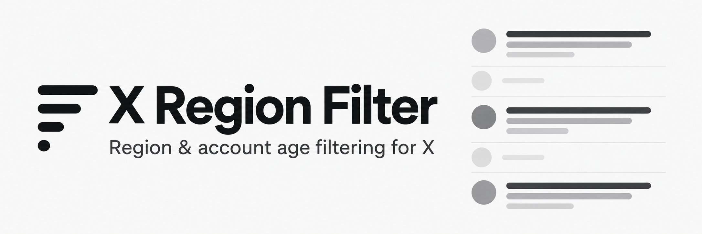

# X Region Filter

A small Chrome and Brave extension that filters X's Home and List feeds by account region and age.

- Choose which countries or regions to hide. Nothing is preselected.
- Filter accounts created in the last three months.
- Apply the same rules to reposts and quoted authors.

It uses X's “Account based in” label and account creation date. Matching posts collapse into a small placeholder. Results are cached, and lookups are paced to respect X's limits, so unfamiliar accounts can remain visible while waiting for a check.

Everything runs in your browser. No analytics or outside lookup service.
