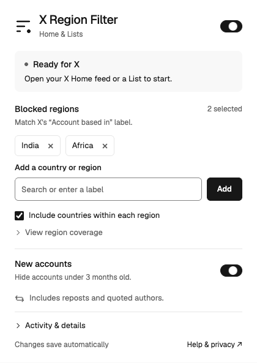

# X Region Filter

Hide posts in your X feed by an account's region or age. The extension runs locally in Chrome and Brave and applies to Home and List timelines, including reposts and quoted posts.

<p></p>

The screenshot shows a fresh installation before connecting to X. The project is independent of X and uses X's web interface, which can change without notice.

## Install

You can load the extension directly from this repository. A build is not required.

1. Clone or download the repository and keep it in a permanent folder.
2. Open `chrome://extensions` or `brave://extensions`.
3. Enable **Developer mode**, click **Load unpacked**, and select the `extension` folder.
4. Open or reload your signed-in X Home feed. Pin the extension from the browser's extensions menu.

Chrome 120 or later is required. Automated browser checks run in the Chromium version pinned by Playwright. The extension is not listed in the Chrome Web Store.

When updating, replace the files at the same installed path, reload the extension on the extensions page, then reload X. Keep only one copy enabled. An unpacked extension's identity depends on its path, so moving it can create a separate installation with separate settings.

## Set your filters

The defaults block **India and Africa**, include countries within each region, and hide accounts created in the last three calendar months. Change these in the popup; every change saves automatically. The top switch pauses filtering while keeping your choices.

Region matching uses X's **Account based in** label. Africa includes its countries and subregions using UN M49 membership. North America combines Northern America, Central America, and the Caribbean. Custom labels, including Middle East, match exactly. Selecting India does not match a broader label such as Asia or South Asia. An account's label does not establish its owner's nationality or precise location.

The age rule uses the account's creation date from the same About response as the region lookup. It stops matching at the three-month anniversary in UTC, with month-end dates clamped to the last valid day. The age switch works independently of the region list. Missing, invalid, and future dates do not trigger it.

A match for the post's author, the original author of a repost, a visible reposter, or a visible quoted author hides the entire feed item. Mentions in the post text do not count. Profiles, individual posts, search, messages, and notifications remain readable.

## Know what's happening

A hidden post becomes a small placeholder that names the matching rule. The extension keeps X's feed rows in place and pauses hidden videos. Pausing the filter restores posts without restarting their videos.

Open the popup on Home or a List to see how many currently mounted posts are hidden. That number can decrease when X removes off-screen rows; it is not a lifetime total. **Activity & details** shows the latest lookup, cached location and age counts, and X's reported About allowance. Refreshing this status does not look up an account.

New authors take time to check. The extension runs one lookup at a time, waits at least 30 seconds after it finishes, and starts at most 20 in a rolling 15 minutes. It also reserves part of X's shared allowance for manual About-page visits. Cached matches continue filtering during a cooldown, while unknown accounts stay visible. Rapid scrolling can outrun the lookup queue.

Account metadata lasts six hours, or five minutes when both fields are missing. Older cache entries that lack creation dates wait for their normal refresh. The extension does not make an extra request just to fill that field. X can change its labels, endpoint, or page structure, and author headers that X does not render cannot be checked.

## Privacy and permissions

Your filters, cached account metadata, and request-limit state stay in your browser. The extension has no analytics, cloud sync, or outside lookup service. It does not post, mute, block, or report accounts on X.

| Permission | Purpose |
| --- | --- |
| `storage` | Save settings, account metadata, and cooldowns locally. Keep the observed Authorization value in session storage. |
| `webRequest` | Passively observe X's request headers, About allowance, and successful lookup identifier. |
| `https://x.com/*` | Read rendered feed authors and make About lookups within your signed-in X tab. |

The extension copies the Authorization header from X's own requests into session-only extension storage. A lookup reads the current CSRF cookie immediately before sending and sends both values only to X. The CSRF value is not saved. X's networking functions and response bodies are not replaced or rewritten.

See [the privacy notes](docs/privacy.md) for storage limits and deletion, and [the architecture](docs/architecture.md) for the message and request paths.

## Develop

Use Node.js 22 or later. OpenSSL is needed for the local HTTPS transport check. There are no runtime npm dependencies; the browser loads the files in `extension` directly.

```sh
npm ci
npx playwright install chromium
npm test
npm run test:performance
npm run build
```

On Linux, use `npx playwright install --with-deps chromium` to install browser system dependencies. Set `CHROMIUM_EXECUTABLE_PATH` to test with another Chromium executable.

`npm test` checks the manifest and assets, matching and request limits, browser behavior, popup controls, and accessibility. The performance command exercises 12,000 synthetic posts and verifies passive header capture over a local HTTPS server. Tests use disposable browser profiles and synthetic X responses. They do not attach to your signed-in browser or spend your X lookup allowance.

`npm run build` writes `dist/x-region-filter-0.5.0.zip` with only the extension's files and checks every archived file against its source. The build uses fixed timestamps and sorted entries. Test reports and screenshots go to `test-results`; both output folders are ignored by Git.

```text
extension/
  manifest.json          Browser entry points and permissions
  background.js          Shared lookup queue, cache, and quota tracking
  shared/                Matching rules, region membership, response parsing
  content/               Feed observation and placeholders
  popup/                 Settings and activity
  help/                  Bundled help and privacy page
  assets/                Local font and extension icons
scripts/                 Validation, packaging, icon generation
tests/                   Rules, browser, popup, and performance checks
docs/                    Architecture, privacy, and contribution notes
```

Read [CONTRIBUTING.md](CONTRIBUTING.md) before changing the lookup path or feed handling. Test coverage and its limits are described in [docs/testing.md](docs/testing.md).

## License

The code is available under the [MIT license](LICENSE). Geist is bundled under the SIL Open Font License; see [third-party notices](THIRD_PARTY_NOTICES.md).
